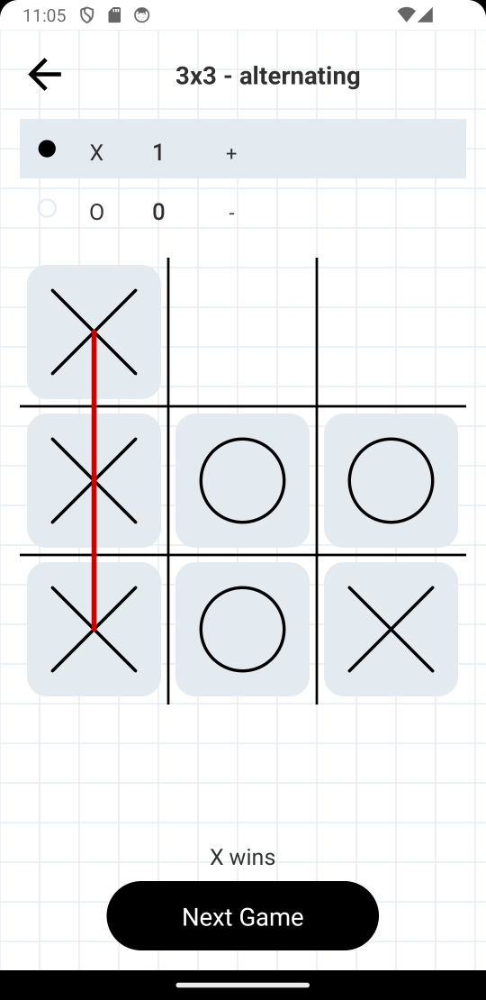

# Tic Tac Toe (XO) for Android

Two-player tic-tac-toe for a single device. Pick the grid size (3x3 or 4x4) and the
starting-player mode, then play X and O turns on the board.

## Game rules

- Win is a full row: 3-in-a-row on 3x3, 4-in-a-row on 4x4 (rows, columns, diagonals).
- **alternating turns** — the starting player alternates each game (game 1 X, game 2 O, ...).
- **always X-first** — X always starts.
- Draw = board full without a line; draws score nothing.
- A win highlights the winning line in red; scores are kept for the session.

## Screens

1. **Setup** — grid size (3x3 / 4x4) and first-player mode; defaults to 3x3 + alternating
   turns; the selected option gets a light-gray background. "Start" begins the game.
2. **Game** — back button (top left) and the mode in the title. Below: a scoreboard
   (X row over O row: turn-indicator circle, bold total wins, last game results as
   `+` win / `-` loss / `=` draw), the square game board with black inner grid lines,
   and a bottom bar that shows whose turn it is during the game and a "Next Game"
   button (transparent and disabled until the game ends).

